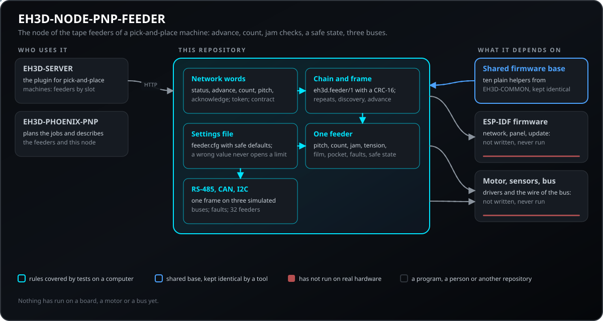
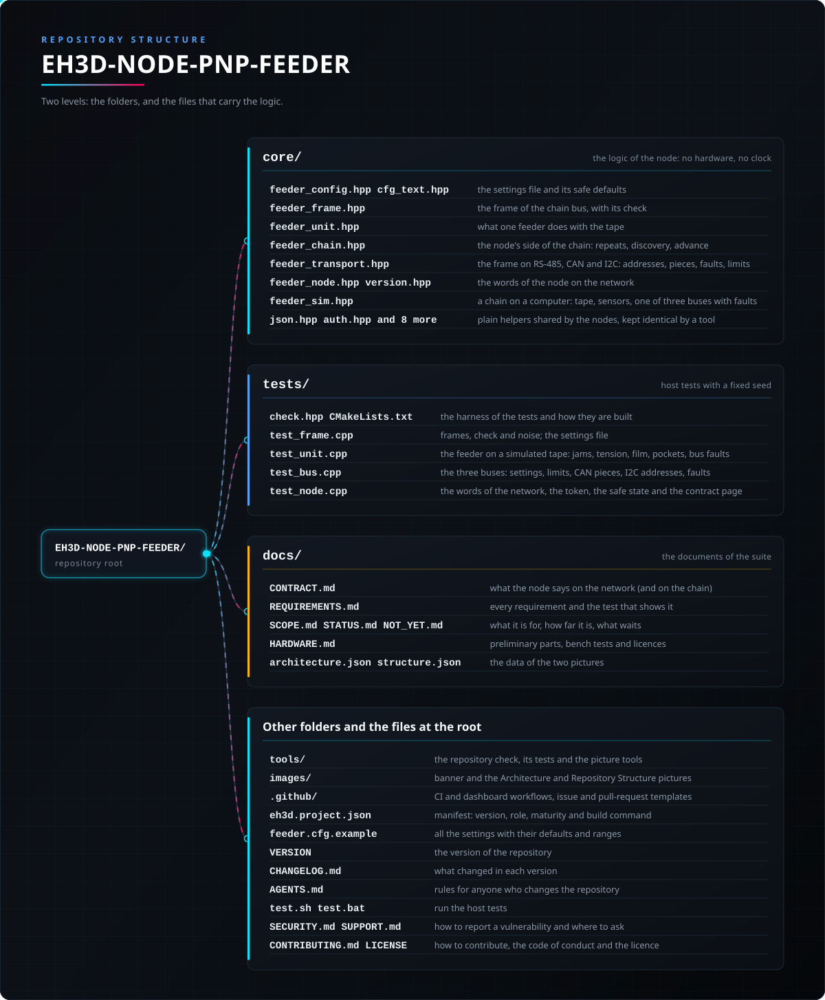

<p align="center">
  
</p>

# 🛠️ EH3D-NODE-PNP-FEEDER

<p align="center"><a href="README.md">🇺🇸 English</a> | <a href="README_spa.md">🇪🇸 Español</a> | <a href="README_fra.md">🇫🇷 Français</a> | <a href="README_ita.md">🇮🇹 Italiano</a> | 🇩🇪 <b>Deutsch</b> | <a href="README_zho.md">🇨🇳 中文</a> | <a href="README_jpn.md">🇯🇵 日本語</a> | <a href="README_por.md">🇵🇹 Português</a></p>

### Der Knoten der Gurtzuführer einer EH3D-Bestückungsmaschine: Vorschub, Zählung, Stau- und Zugprüfung, geschrieben und gegen einen Simulator erprobt

<p align="center">
  
  
  
  
  
  
</p>

---

**Ehrlichkeitscheck - was heute tatsächlich läuft:** ein Gerüst mit echter, getesteter Logik und ohne Hardware. Die Regeln des Knotens laufen auf einem Rechner gegen einen Simulator (102 Tests bestehen), aber nichts davon wurde als Firmware gebaut, geflasht oder mit einem Motor, einem Gurtsensor oder einem Zuführerbus verbunden.

---

> **Stand von Sicherheit und IT-Sicherheit:** dieser Knoten ist kein Sicherheitssystem. Seine Verriegelungen und sein sicherer Zustand sind eine zweite Linie hinter Stopp, Grenzen und Verriegelungen der Maschine und ihrer Steuerung und ersetzen diese nie.

## 📋 Auf einen Blick

| | |
|---|---|
| Version | `0.0.2` |
| Reifegrad | Gerüst |
| Tests | 102 |
| Technologie-Stack | C++17 (host tests), Python 3.10+ |
| Auf echter Hardware | Noch nicht auf Hardware ausgeführt |

**Springe zu:** [Überblick](#-überblick) · [Architektur](#-architektur) · [Schnellstart](#-schnellstart) · [Tests](#-tests) · [Struktur des Repositorys](#-struktur-des-repositorys) · [Verwandte Projekte](#-verwandte-projekte)

## 🚦 Projektstatus

Jede Zeile ist ein Teil dieses Repositorys, und die Ampel sagt, wie weit er heute ist. Sie beruht auf dem, was das Repository zeigen kann (Tests, Builds, Läufe), nicht auf dem, was geplant ist.

🟢 Fertig und überprüft · 🟡 Funktioniert, mit bekannten Grenzen · 🟠 Teilweise fertig oder noch nicht überprüft · 🔴 Nicht gemacht oder funktioniert nicht

| Bereich | Stand | Was das hier bedeutet |
|---|---|---|
| Logik und Simulator | 🟡 | Die Regeln des Knotens laufen gegen einen Simulator mit festem Seed; 102 Tests bestehen auf einem Rechner. |
| Netzwerkvertrag | 🟡 | Die Worte des Knotens stehen in docs/CONTRACT.md und ein Test schlägt fehl, wenn Seite und Antworten abweichen; das Plugin des Servers nutzt diesen Knoten noch nicht. |
| Firmware | 🟠 | Die Firmware für die Platine ist noch nicht geschrieben: nur die einfachen Helfer der gemeinsamen Basis sind importiert. |
| Echte Hardware | 🔴 | Auf einem Motor, einem Gurtsensor oder einem Zuführerbus ist noch nichts gelaufen. |

## 🎯 Überblick

* **Ein Knoten, eine Kette von Zuführern:** er schiebt den Gurt jedes Zuführers um einen Schritt von 2, 4, 8, 12 oder 16 mm vor, zählt die Teile, prüft Tasche, Zug und Deckfolie, hält bei einem Gurtstau einen Fehler und hält von selbst an, wenn er den Knoten oder den Server verliert.
* **Drei Busse, ein Rahmen:** derselbe Rahmen `eh3d.feeder/1` läuft über RS-485 (mit der Richtungsleitung des Transceivers), CAN (in Stücken von sieben Bytes) oder I2C (mit 7-Bit-Adressen), gewählt in `feeder.cfg`, mit bis zu 32 Zuführern an jedem; jeder Bus wird gegen einen Simulator mit verlorenen, beschädigten, verspäteten und kollidierenden Rahmen getestet.

## 🧩 Rolle in EH3D

Das Programm für Pick and Place plant die Aufträge und sagt, welcher Zuführer welches Teil hält; dieser Knoten steht künftig hinter einem Zuführerplatz, sobald eine echte Maschine angeschlossen ist. Heute existiert er nur als Logik und Simulator.

## 🏛️ Architektur

<p align="center">
  
</p>

Wie die Teile dieses Repositorys zusammenpassen: wer es nutzt, was es enthält und wovon es abhängt. Das Bild wird aus `docs/architecture.json` gezeichnet und gegen den Code geprüft.

## 🔒 Sicherheit und Schutz

Die Sicherheitsregeln dieses Knotens; der Test, der jede zeigt, ist in docs/REQUIREMENTS.md genannt:

* Ein Knoten ohne Token weist jede Anfrage ab, die etwas bewegt oder ändert; das Token wird nie angezeigt, zurückgeschrieben oder protokolliert.
* Hört der Knoten den Server nicht, geht er von selbst in einen sicheren Zustand und bewegt nichts, bis eine Person quittiert.
* Jede Grenze ist eine Einstellung mit vorsichtigem Standardwert, und ein falscher Wert lockert nie eine: er wird abgewiesen und der Standardwert bleibt.

## 🔌 Schnittstellen

Server, Programme und Telefone sprechen mit dem Knoten über HTTP wie die anderen Knoten der Suite (JSON und ein Bearer-Token); der Knoten spricht mit seinen Zuführern über RS-485, CAN oder I2C (die Einstellung `bus` wählt) mit dem Rahmen `eh3d.feeder/1`. Die Seite [docs/CONTRACT.md](docs/CONTRACT.md) ist der Vertrag und ein Test hält sie mit den Antworten gleich.

```text
GET  /api/status                         the node and all its feeders (always answered)
GET  /api/feeder?slot=N                  one feeder
POST /api/feeder/advance?slot=N[&count=K]   move the tape K pitches and answer when the move is over
POST /api/feeder/retract?slot=N[&count=K]   the same backwards (off unless the settings allow it)
POST /api/feeder/identify?slot=N         blink and tell the firmware version
POST /api/feeder/count?slot=N&n=K        parts left in the tape
POST /api/feeder/pitch?slot=N&mm=P       2, 4, 8, 12 or 16
POST /api/feeder/ack[?slot=N]            clear a fault that is gone (or the safe state, without a slot)
POST /api/feeder/stop                    stop every feeder
POST /api/discover                       ask every slot who is there
```

## ⚙️ Konfiguration

Jeder abgestimmte Wert steht in `feeder.cfg`; `feeder.cfg.example` zeigt alle mit Standardwerten und Bereichen. Ein Wert außerhalb des Bereichs oder ein unbekannter Schlüssel wird gemeldet und der Standardwert bleibt.

## 🚀 Schnellstart

Sie brauchen einen C++17-Compiler, CMake 3.16 oder neuer und Python 3.10 oder neuer; sonst ist nichts zu installieren.

```bash
cmake -S tests -B build/host
cmake --build build/host
ctest --test-dir build/host --output-on-failure
python -I tools/ci_validate.py
python -I -m unittest discover -s tools -p "test_*.py"
```

## 🧪 Tests

102 Tests: C++-Tests auf dem Rechner mit festem Seed (sie lassen den Simulator und die Netzwerkworte laufen und vergleichen die Vertragsseite mit den Antworten) und Python-Tests des Repositorys. Die CI führt die C++-Tests auch mit AddressSanitizer und UBSan aus.

## 🏗️ Build und Veröffentlichung

Die Version steht in `eh3d.project.json` und jede Version hat ihren Eintrag in [CHANGELOG.md](CHANGELOG.md). Einen Firmware-Build gibt es noch nicht; sobald es Firmware gibt, wird sie nur in GitHub Actions gebaut. Die Software ist GPL-3.0-or-later; die mechanischen Teile des Knotens sollen unter CC-BY-SA und seine Elektronik unter CERN-OHL-S veröffentlicht werden (siehe [docs/HARDWARE.md](docs/HARDWARE.md)).

## 📂 Struktur des Repositorys

<p align="center">
  
</p>

<details>
<summary>Textversion des Baums</summary>

```text
EH3D-NODE-PNP-FEEDER/
├── core/
│   ├── feeder_config.hpp cfg_text.hpp                                                                                                       die Einstellungsdatei und ihre sicheren Standardwerte
│   ├── feeder_frame.hpp                                                                                                                     der Rahmen des Kettenbusses mit seiner Prüfung
│   ├── feeder_unit.hpp                                                                                                                      was ein Zuführer mit dem Gurt tut
│   ├── feeder_chain.hpp                                                                                                                     die Knotenseite der Kette: Wiederholungen, Erkennung, Vorschub
│   ├── feeder_transport.hpp                                                                                                                 der Rahmen auf RS-485, CAN und I2C: Adressen, Teile, Fehler, Grenzen
│   ├── feeder_node.hpp version.hpp                                                                                                          die Worte des Knotens im Netzwerk
│   ├── feeder_sim.hpp                                                                                                                       eine Kette am Rechner: Gurt, Sensoren, einer von drei Bussen mit Fehlern
│   └── json.hpp auth.hpp semver.hpp backoff.hpp task_health.hpp stored_load.hpp memory_budget.hpp net_text.hpp node_id.hpp civil_time.hpp   einfache Helfer, die alle Knoten teilen und ein Werkzeug gleich hält
├── tests/
│   ├── check.hpp CMakeLists.txt                                                                                                             der Rahmen der Tests und wie sie gebaut werden
│   ├── test_frame.cpp                                                                                                                       Rahmen, Prüfung und Rauschen; die Einstellungsdatei
│   ├── test_unit.cpp                                                                                                                        der Zuführer an einem simulierten Gurt: Staus, Zug, Folie, Taschen, Busfehler
│   ├── test_bus.cpp                                                                                                                         die drei Busse: Einstellungen, Grenzen, CAN-Teile, I2C-Adressen, Fehler
│   └── test_node.cpp                                                                                                                        die Netzwerkworte, das Token, der sichere Zustand und die Vertragsseite
├── docs/
│   ├── CONTRACT.md                                                                                                                          was der Knoten im Netzwerk (und in der Kette) sagt
│   ├── REQUIREMENTS.md                                                                                                                      jede Anforderung und der Test, der sie zeigt
│   ├── SCOPE.md STATUS.md NOT_YET.md                                                                                                        wofür es da ist, wie weit es ist, was wartet
│   ├── HARDWARE.md                                                                                                                          vorläufige Teile, Prüfstandtests und Lizenzen
│   └── architecture.json structure.json                                                                                                     die Daten der beiden Bilder
├── tools/                                                                                                                                   die Repository-Prüfung, ihre Tests und die Bild-Werkzeuge
├── images/                                                                                                                                  Banner und die Bilder von Architektur und Repository-Struktur
├── .github/                                                                                                                                 CI- und Dashboard-Workflows, Vorlagen für Issues und Pull Requests
├── eh3d.project.json                                                                                                                        Manifest: Version, Rolle, Reifegrad und Build-Befehl
├── feeder.cfg.example                                                                                                                       alle Einstellungen mit Standardwerten und Bereichen
├── VERSION                                                                                                                                  die Version des Repositorys
├── CHANGELOG.md                                                                                                                             was sich in jeder Version geändert hat
├── AGENTS.md                                                                                                                                Regeln für alle, die das Repository ändern
├── test.sh test.bat                                                                                                                         die Rechnertests ausführen
├── SECURITY.md SUPPORT.md                                                                                                                   Schwachstellen melden und Fragen stellen
└── CONTRIBUTING.md CODE_OF_CONDUCT.md LICENSE                                                                                               Mitwirken, Verhaltenskodex und Lizenz
```

</details>

## 🗺️ Roadmap und bekannte Grenzen

**Bekannte Grenzen heute**

* Es sind weder Firmware noch Motortreiber, Gurtsensor oder Bus-Transceiver geschrieben; der simulierte Gurt und das Rauschen sind erfunden. Die Adresse eines Zuführers ist sein Platz: die automatische Adressierung der Kette ist nicht geschrieben.

**Als Nächstes**

* Die ESP-IDF-Firmware auf der gemeinsamen Basis, die Treiber für Motor und Gurtsensoren, danach ein erster Test eines Zuführers auf dem Prüfstand.

## 🌍 Sprachen

README und Texte gibt es auf Englisch, Spanisch, Französisch, Italienisch, Deutsch, Chinesisch, Japanisch und europäischem Portugiesisch.

## 🔗 Verwandte Projekte

* [EH3D-PHOENIX-PNP](https://github.com/JuanenRac/EH3D-PHOENIX-PNP): das Pick-and-Place-Programm, das die Aufträge plant und diesen Knoten beschreibt
* [EH3D-SERVER](https://github.com/JuanenRac/EH3D-SERVER): der Server, dessen Plugin für Pick-and-Place-Maschinen hinter diesem Knoten stehen wird
* [EH3D-COMMON](https://github.com/JuanenRac/EH3D-COMMON): die Firmware-Basis, aus der dieser Knoten seine einfachen Helfer nimmt
* [EH3D-NODE-PNP-HEAD](https://github.com/JuanenRac/EH3D-NODE-PNP-HEAD): der Knoten des Kopfs, der die Teile aufnimmt und setzt

## 📚 Dokumentation

* [Die Konventionen der Suite](https://github.com/JuanenRac/EH3D-DOCS/blob/main/docs/CONVENTIONS.md)
* [Der Vertrag des Knotens](docs/CONTRACT.md)
* [Anforderungen und der Test zu jeder](docs/REQUIREMENTS.md)
* [Umfang](docs/SCOPE.md), [Stand](docs/STATUS.md) und [was noch nicht gemacht ist](docs/NOT_YET.md)
* [Hardware: vorläufige Teile, Prüfstandtests und Lizenzen](docs/HARDWARE.md)
* [Änderungsprotokoll](CHANGELOG.md)

## 🤝 Mitwirken und Community

* Führe vor einem Pull Request `python -I tools/ci_validate.py` und die Tests der Basis aus: alles muss bestehen. Siehe [CONTRIBUTING.md](CONTRIBUTING.md) und den [Verhaltenskodex](CODE_OF_CONDUCT.md).
* Das README gibt es in acht Sprachen: Eine Textänderung wird in allen acht Dateien gemacht, und die beiden Bilder werden aus `docs/architecture.json` und `docs/structure.json` mit `tools/make_architecture.py` und `tools/make_structure.py` gezeichnet.
* Melde eine Schwachstelle privat: [SECURITY.md](SECURITY.md). Fragen, Ideen und Meldungen: electrohobby3d@gmail.com ([SUPPORT.md](SUPPORT.md)).

## 👤 AUTOR

**JuanenRac (Electro Hobby 3D)** · electrohobby3d@gmail.com

## 📜 LIZENZ

Software: GPL-3.0-or-later. Siehe [LICENSE](LICENSE). Hardware: die mechanischen Teile sind für CC-BY-SA vorgesehen, die Elektronik für CERN-OHL-S (siehe [docs/HARDWARE.md](docs/HARDWARE.md)).
