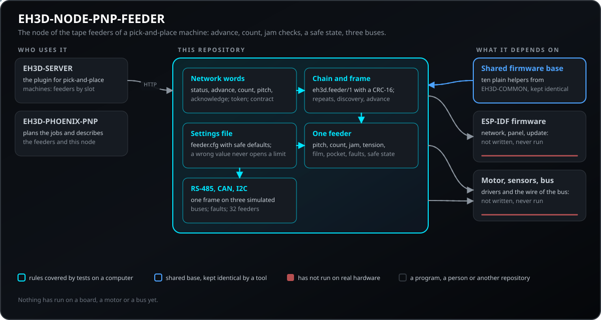
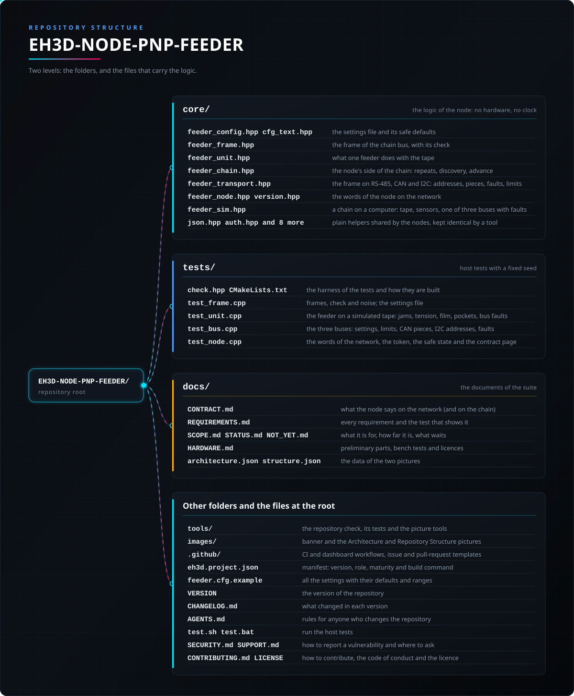

<p align="center">
  
</p>

# 🛠️ EH3D-NODE-PNP-FEEDER

<p align="center"><a href="README.md">🇺🇸 English</a> | <a href="README_spa.md">🇪🇸 Español</a> | 🇫🇷 <b>Français</b> | <a href="README_ita.md">🇮🇹 Italiano</a> | <a href="README_deu.md">🇩🇪 Deutsch</a> | <a href="README_zho.md">🇨🇳 中文</a> | <a href="README_jpn.md">🇯🇵 日本語</a> | <a href="README_por.md">🇵🇹 Português</a></p>

### Le nœud des alimentateurs de bande d'une machine de placement EH3D : avance, comptage, contrôle du bourrage et de la tension, écrit et essayé contre un simulateur

<p align="center">
  
  
  
  
  
  
</p>

---

**Vérification d'honnêteté - ce qui tourne aujourd'hui :** un squelette avec une logique réelle et testée et sans matériel. Les règles du nœud s'exécutent sur un ordinateur contre un simulateur (68 tests réussis), mais rien ici n'a été compilé en firmware, flashé ni relié à un moteur, un capteur de bande ou un bus d'alimentateurs.

---

> **État de la sûreté et de la sécurité :** ce nœud n'est pas un système de sécurité. Ses verrouillages et son état sûr sont une seconde ligne derrière l'arrêt, les limites et les verrouillages de la machine et de son contrôleur, et ne les remplacent jamais.

## 📋 En un coup d'œil

| | |
|---|---|
| Version | `0.0.1` |
| Maturité | Échafaudage |
| Tests | 68 |
| Pile technique | C++17 (host tests), Python 3.10+ |
| Sur du matériel réel | Pas encore exécuté sur du matériel |

**Aller à  :** [Présentation](#-présentation) · [Architecture](#-architecture) · [Démarrage rapide](#-démarrage-rapide) · [Tests](#-tests) · [Structure du dépôt](#-structure-du-dépôt) · [Projets liés](#-projets-liés)

## 🚦 État du projet

Chaque ligne est une partie de ce dépôt et le feu dit où elle en est aujourd'hui. Elle est écrite d'après ce que le dépôt peut montrer (tests, compilations, exécutions), pas d'après ce qui est prévu.

🟢 Fait et vérifié · 🟡 Fonctionne, avec des limites connues · 🟠 À moitié fait ou pas encore vérifié · 🔴 Pas fait ou ne fonctionne pas

| Domaine | État | Ce que cela veut dire ici |
|---|---|---|
| Logique et simulateur | 🟡 | Les règles du nœud s'exécutent contre un simulateur à graine fixe ; 68 tests réussissent sur un ordinateur. |
| Contrat réseau | 🟡 | Les mots du nœud sont écrits dans docs/CONTRACT.md et un test échoue quand la page et les réponses diffèrent ; le plugin du serveur n'utilise pas encore ce nœud. |
| Firmware | 🟠 | Le firmware de la carte n'est pas encore écrit : seuls les utilitaires simples de la base commune sont importés. |
| Matériel réel | 🔴 | Rien n'a tourné sur un moteur, un capteur de bande ou un bus d'alimentateurs. |

## 🎯 Présentation

* **Un nœud, une chaîne d'alimentateurs :** il avance la bande de chaque alimentateur d'un pas de 2, 4, 8, 12 ou 16 mm, compte les pièces, vérifie l'alvéole, la tension et le film de couverture, retient un défaut quand la bande se bloque et s'arrête seul s'il perd le nœud ou le serveur.

## 🧩 Rôle dans EH3D

Le programme de placement planifie les travaux et dit quel alimentateur porte chaque pièce ; ce nœud sera ce qui se trouve derrière un emplacement d'alimentateur quand une machine réelle sera reliée. Aujourd'hui il n'existe que comme logique et simulateur.

## 🏛️ Architecture

<p align="center">
  
</p>

Comment les parties de ce dépôt s'articulent : qui l'utilise, ce qu'il contient et de quoi il dépend. L'image est dessinée à partir de `docs/architecture.json` et vérifiée par rapport au code.

## 🔒 Sécurité et protection

Les règles de sûreté et de sécurité de ce nœud ; le test qui montre chacune est nommé dans docs/REQUIREMENTS.md :

* Un nœud sans jeton refuse toute requête qui déplace ou change quelque chose ; le jeton n'est jamais affiché, réécrit ni journalisé.
* Quand le serveur n'est plus entendu, le nœud passe seul à un état sûr et ne déplace rien tant qu'une personne n'a pas acquitté.
* Chaque limite est un réglage à valeur par défaut prudente, et une valeur erronée n'en relâche jamais une : elle est refusée et la valeur par défaut reste.

## 🔌 Interfaces

Le serveur, les programmes et les téléphones parlent au nœud en HTTP comme les autres nœuds de la suite (JSON et un jeton bearer) ; le nœud parle à ses alimentateurs par un bus série avec la trame `eh3d.feeder/1`. La page [docs/CONTRACT.md](docs/CONTRACT.md) est le contrat et un test la garde identique aux réponses.

```text
GET  /api/status                         the node and all its feeders (always answered)
GET  /api/feeder?slot=N                  one feeder
POST /api/feeder/advance?slot=N[&count=K]   move the tape K pitches and answer when the move is over
POST /api/feeder/retract?slot=N[&count=K]   the same backwards (off unless the settings allow it)
POST /api/feeder/identify?slot=N         blink and tell the firmware version
POST /api/feeder/count?slot=N&n=K        parts left in the tape
POST /api/feeder/pitch?slot=N&mm=P       2, 4, 8, 12 or 16
POST /api/feeder/ack[?slot=N]            clear a fault that is gone (or the safe state, without a slot)
POST /api/feeder/stop                    stop every feeder
POST /api/discover                       ask every slot who is there
```

## ⚙️ Configuration

Chaque valeur ajustée est dans `feeder.cfg` ; `feeder.cfg.example` les montre toutes avec leurs valeurs par défaut et leurs plages. Une valeur hors plage, ou une clé inconnue, est signalée et la valeur par défaut reste.

## 🚀 Démarrage rapide

Il faut un compilateur C++17, CMake 3.16 ou plus récent et Python 3.10 ou plus récent ; rien d'autre à installer.

```bash
cmake -S tests -B build/host
cmake --build build/host
ctest --test-dir build/host --output-on-failure
python -I tools/ci_validate.py
python -I -m unittest discover -s tools -p "test_*.py"
```

## 🧪 Tests

68 tests : tests C++ sur ordinateur à graine fixe (ils font tourner le simulateur et les mots du réseau et comparent la page du contrat aux réponses) et tests Python du dépôt. La CI exécute aussi les tests C++ avec AddressSanitizer et UBSan.

## 🏗️ Compilation et publication

La version vit dans `eh3d.project.json` et chaque version a son entrée dans [CHANGELOG.md](CHANGELOG.md). Il n'y a pas encore de compilation du firmware ; quand il existera, il sera compilé seulement dans GitHub Actions. Le logiciel est sous GPL-3.0-or-later ; les pièces mécaniques du nœud seront publiées sous CC-BY-SA et son électronique sous CERN-OHL-S (voir [docs/HARDWARE.md](docs/HARDWARE.md)).

## 📂 Structure du dépôt

<p align="center">
  
</p>

<details>
<summary>Version texte de l'arborescence</summary>

```text
EH3D-NODE-PNP-FEEDER/
├── core/
│   ├── feeder_config.hpp cfg_text.hpp                                                                                                       le fichier de réglages et ses valeurs sûres
│   ├── feeder_frame.hpp                                                                                                                     la trame du bus de la chaîne, avec son contrôle
│   ├── feeder_unit.hpp                                                                                                                      ce que fait un alimentateur de la bande
│   ├── feeder_chain.hpp                                                                                                                     le côté nœud de la chaîne : répétitions, découverte, avance
│   ├── feeder_node.hpp version.hpp                                                                                                          les mots du nœud sur le réseau
│   ├── feeder_sim.hpp                                                                                                                       une chaîne d'alimentateurs sur un ordinateur, pour les tests
│   └── json.hpp auth.hpp semver.hpp backoff.hpp task_health.hpp stored_load.hpp memory_budget.hpp net_text.hpp node_id.hpp civil_time.hpp   utilitaires simples partagés par les nœuds, gardés identiques par un outil
├── tests/
│   ├── check.hpp CMakeLists.txt                                                                                                             le cadre des tests et leur compilation
│   ├── test_frame.cpp                                                                                                                       trames, contrôle et bruit ; le fichier de réglages
│   ├── test_unit.cpp                                                                                                                        l'alimentateur sur une bande simulée : bourrages, tension, film, alvéoles, pannes du bus
│   └── test_node.cpp                                                                                                                        les mots du réseau, le jeton, l'état sûr et la page du contrat
├── docs/
│   ├── CONTRACT.md                                                                                                                          ce que dit le nœud sur le réseau (et sur la chaîne)
│   ├── REQUIREMENTS.md                                                                                                                      chaque exigence et le test qui la montre
│   ├── SCOPE.md STATUS.md NOT_YET.md                                                                                                        à quoi il sert, où il en est, ce qui attend
│   ├── HARDWARE.md                                                                                                                          pièces préliminaires, essais sur banc et licences
│   └── architecture.json structure.json                                                                                                     les données des deux images
├── tools/                                                                                                                                   le contrôle du dépôt, ses tests et les outils des images
├── images/                                                                                                                                  bannière et images d'Architecture et de Structure du dépôt
├── .github/                                                                                                                                 workflows de CI et du tableau de bord, modèles d'issues et de pull requests
├── eh3d.project.json                                                                                                                        manifeste : version, rôle, maturité et commande de compilation
├── feeder.cfg.example                                                                                                                       tous les réglages avec leurs valeurs par défaut et plages
├── VERSION                                                                                                                                  la version du dépôt
├── CHANGELOG.md                                                                                                                             ce qui a changé dans chaque version
├── AGENTS.md                                                                                                                                règles pour quiconque modifie le dépôt
├── test.sh test.bat                                                                                                                         lancer les tests sur ordinateur
├── SECURITY.md SUPPORT.md                                                                                                                   signaler une vulnérabilité et poser des questions
└── CONTRIBUTING.md CODE_OF_CONDUCT.md LICENSE                                                                                               contribuer, code de conduite et licence
```

</details>

## 🗺️ Feuille de route et limites connues

**Limites connues aujourd'hui**

* Ni firmware, ni pilote de moteur, ni capteur de bande, ni émetteur-récepteur de bus ne sont écrits ; la bande et le bruit simulés sont inventés. L'adresse d'un alimentateur est son emplacement : l'adressage automatique de la chaîne n'est pas écrit.

**Ensuite**

* Le firmware ESP-IDF sur la base commune, les pilotes du moteur et des capteurs de bande, puis un premier essai sur banc d'un alimentateur.

## 🌍 Langues

Le README et les textes existent en anglais, espagnol, français, italien, allemand, chinois, japonais et portugais européen.

## 🔗 Projets liés

* [EH3D-PHOENIX-PNP](https://github.com/JuanenRac/EH3D-PHOENIX-PNP) : le programme de placement qui planifie les travaux et décrit ce nœud
* [EH3D-SERVER](https://github.com/JuanenRac/EH3D-SERVER) : le serveur dont le plugin des machines de placement sera derrière ce nœud
* [EH3D-COMMON](https://github.com/JuanenRac/EH3D-COMMON) : la base de firmware dont ce nœud tire ses utilitaires simples
* [EH3D-NODE-PNP-HEAD](https://github.com/JuanenRac/EH3D-NODE-PNP-HEAD) : le nœud de la tête qui prend et pose les pièces

## 📚 Documentation

* [Les conventions de la suite](https://github.com/JuanenRac/EH3D-DOCS/blob/main/docs/CONVENTIONS.md)
* [Le contrat du nœud](docs/CONTRACT.md)
* [Exigences et le test de chacune](docs/REQUIREMENTS.md)
* [Périmètre](docs/SCOPE.md), [état](docs/STATUS.md) et [ce qui n'est pas encore fait](docs/NOT_YET.md)
* [Matériel : pièces préliminaires, essais sur banc et licences](docs/HARDWARE.md)
* [Journal des modifications](CHANGELOG.md)

## 🤝 Contribuer et communauté

* Avant une pull request, exécutez `python -I tools/ci_validate.py` et les tests de la base : tout doit réussir. Voir [CONTRIBUTING.md](CONTRIBUTING.md) et le [code de conduite](CODE_OF_CONDUCT.md).
* Le README existe en huit langues : une modification du texte se fait dans les huit fichiers, et les deux images sont dessinées à partir de `docs/architecture.json` et `docs/structure.json` par `tools/make_architecture.py` et `tools/make_structure.py`.
* Signalez une vulnérabilité en privé : [SECURITY.md](SECURITY.md). Questions, idées et rapports : electrohobby3d@gmail.com ([SUPPORT.md](SUPPORT.md)).

## 👤 AUTEUR

**JuanenRac (Electro Hobby 3D)** · electrohobby3d@gmail.com

## 📜 LICENCE

Logiciel : GPL-3.0-or-later. Voir [LICENSE](LICENSE). Matériel : les pièces mécaniques sont prévues sous CC-BY-SA et l'électronique sous CERN-OHL-S (voir [docs/HARDWARE.md](docs/HARDWARE.md)).
