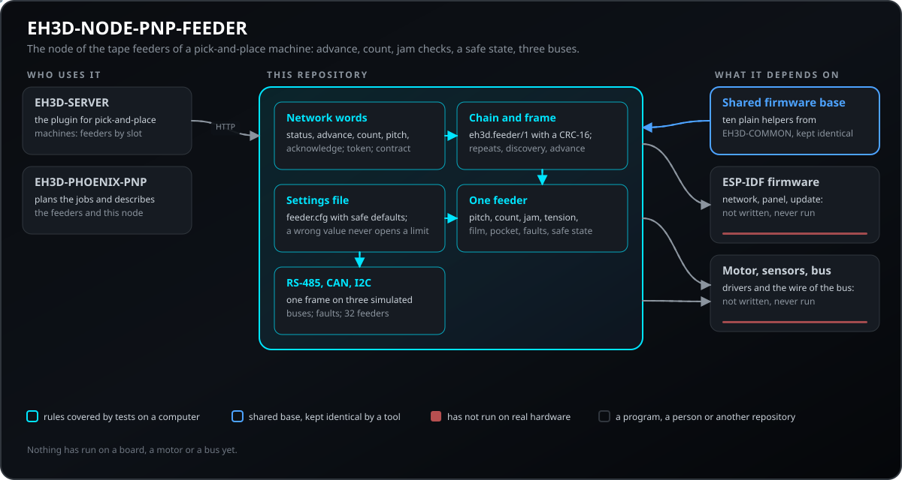
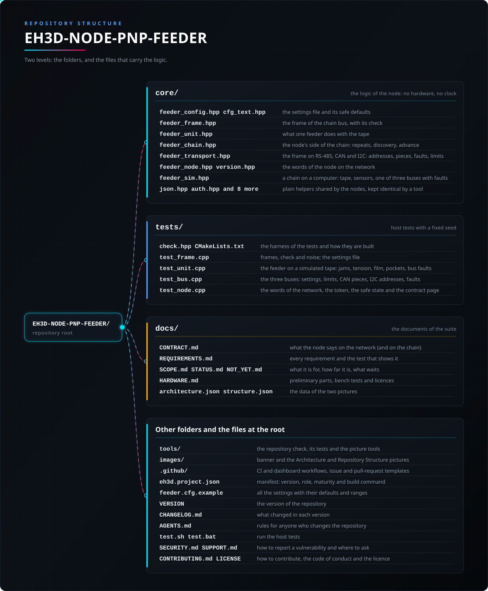

<p align="center">
  
</p>

# 🛠️ EH3D-NODE-PNP-FEEDER

<p align="center"><a href="README.md">🇺🇸 English</a> | <a href="README_spa.md">🇪🇸 Español</a> | <a href="README_fra.md">🇫🇷 Français</a> | <a href="README_ita.md">🇮🇹 Italiano</a> | <a href="README_deu.md">🇩🇪 Deutsch</a> | <a href="README_zho.md">🇨🇳 中文</a> | 🇯🇵 <b>日本語</b> | <a href="README_por.md">🇵🇹 Português</a></p>

### EH3D のピックアンドプレース機のテープフィーダー用ノード。送り、カウント、詰まりと張力の検査を実装し、シミュレータで試験済み

<p align="center">
  
  
  
  
  
  
</p>

---

**正直さの確認 - 今日実際に動くもの：** シミュレーションで動作するノードです。ロジックは実物でテスト済みですが、ファームウェアもハードウェアもありません。ノードの規則はコンピュータ上でシミュレータに対して動作します（105 件のテストが成功）が、ここにあるものはファームウェアとしてビルドされたことも、書き込まれたことも、モーター、テープセンサー、フィーダーのバスに接続されたこともありません。

---

> **安全性とセキュリティの現状：** このノードは安全システムではありません。インターロックと安全状態は、機械とそのコントローラの停止・リミット・インターロックの後ろにある第二の防御線であり、それらを置き換えることはありません。

## 📋 ひと目で

| | |
|---|---|
| バージョン | `0.0.2` |
| 成熟度 | 機能する |
| テスト | 105 |
| 技術スタック | C++17 (host tests), Python 3.10+ |
| 実機での動作 | まだハードウェアでは実行していません |

**移動先：** [概要](#-概要) · [アーキテクチャ](#-アーキテクチャ) · [クイックスタート](#-クイックスタート) · [テスト](#-テスト) · [リポジトリの構成](#-リポジトリの構成) · [関連プロジェクト](#-関連プロジェクト)

## 🚦 プロジェクトの状況

各行はこのリポジトリの一部分で、信号は今日どこまで進んでいるかを示します。計画ではなく、リポジトリが示せるもの（テスト、ビルド、実行）に基づいて書かれています。

🟢 完了・検証済み · 🟡 動作する（既知の制限あり） · 🟠 一部のみ、または未検証 · 🔴 未実装または動作しない

| 領域 | 状態 | ここでの意味 |
|---|---|---|
| ロジックとシミュレータ | 🟡 | ノードの規則は固定シードのシミュレータに対して動作し、105 件のテストがコンピュータ上で成功します。 |
| ネットワーク契約 | 🟡 | ノードの語は docs/CONTRACT.md に書かれており、ページと応答が異なるとテストが失敗します。サーバーのプラグインはまだこのノードを使っていません。 |
| ファームウェア | 🟠 | ボード用のファームウェアはまだ書かれていません。共有ベースの単純な補助部分だけを取り込んでいます。 |
| 実機ハードウェア | 🔴 | モーター、テープセンサー、フィーダーのバスでは何も動いていません。 |

## 🎯 概要

* **1 つのノード、フィーダーのチェーン：** 各フィーダーのテープを 2、4、8、12、16 mm のピッチで送り、部品を数え、ポケット・張力・カバーフィルムを確認し、テープが詰まるとエラーを保持し、ノードやサーバーを失うと自分で停止します。
* **3 種のバス、1 つのフレーム：** 同じフレーム `eh3d.feeder/1` が、`feeder.cfg` で選んだ RS-485（トランシーバーの方向制御線付き）、CAN（7 バイトずつに分割）、I2C（7 ビットアドレス）のいずれかで流れ、どれでも最大 32 台のフィーダーを接続できます。各バスは、欠落・破損・遅延・衝突したフレームを出すシミュレーターで試されています。

## 🧩 EH3D での役割

ピックアンドプレースのプログラムが作業を計画してどのフィーダーがどの部品を持つかを示します。このノードは、実機を接続したときにフィーダーのスロットの裏で動くものです。現在はロジックとシミュレータとしてのみ存在します。

## 🏛️ アーキテクチャ

<p align="center">
  
</p>

このリポジトリの各部分の関係：誰が使い、何を持ち、何に依存するか。図は `docs/architecture.json` から描かれ、コードと照合されます。

## 🔒 セキュリティと安全

このノードの安全規則です。各規則を示すテストは docs/REQUIREMENTS.md に名前が書かれています。

* トークンのないノードは、動かしたり変更したりする要求をすべて拒否します。トークンは表示も、書き戻しも、ログ出力もされません。
* サーバーの応答がなくなると、ノードは自分で安全状態に移り、人が確認するまで何も動かしません。この時間は尋ねられなくてもノードが知らせます。`GET /api/status` の `server_lost_ms` で、値は設定のとおりです。
* すべての制限は保守的な既定値を持つ設定で、誤った値が制限を緩めることはありません。拒否されて既定値が残ります。

## 🔌 インターフェース

サーバー、プログラム、スマートフォンは、スイートの他のノードと同じ方法（JSON とベアラートークン）で HTTP によりノードと通信します。ノードは設定 `bus` で選んだ RS-485、CAN、I2C のいずれかで、フレーム `eh3d.feeder/1` を使ってフィーダーと通信します。ページ [docs/CONTRACT.md](docs/CONTRACT.md) が契約であり、テストが応答との一致を保ちます。

```text
GET  /api/status                         the node and all its feeders (always answered)
GET  /api/feeder?slot=N                  one feeder
POST /api/feeder/advance?slot=N[&count=K]   move the tape K pitches and answer when the move is over
POST /api/feeder/retract?slot=N[&count=K]   the same backwards (off unless the settings allow it)
POST /api/feeder/identify?slot=N         blink and tell the firmware version
POST /api/feeder/count?slot=N&n=K        parts left in the tape
POST /api/feeder/pitch?slot=N&mm=P       2, 4, 8, 12 or 16
POST /api/feeder/ack[?slot=N]            clear a fault that is gone (or the safe state, without a slot)
POST /api/feeder/stop                    stop every feeder
POST /api/discover                       ask every slot who is there
```

## ⚙️ 設定

調整する値はすべて `feeder.cfg` にあります。`feeder.cfg.example` に既定値と範囲付きですべて示されています。範囲外の値や未知のキーは報告され、既定値が残ります。

## 🚀 クイックスタート

C++17 コンパイラ、CMake 3.16 以降、Python 3.10 以降が必要です。ほかにインストールするものはありません。

```bash
cmake -S tests -B build/host
cmake --build build/host
ctest --test-dir build/host --output-on-failure
python -I tools/ci_validate.py
python -I -m unittest discover -s tools -p "test_*.py"
```

## 🧪 テスト

105 件のテスト：固定シードの C++ ホストテスト（シミュレータとネットワークの語を動かし、契約ページと応答を比較）と、リポジトリの Python テストです。CI は C++ テストを AddressSanitizer と UBSan でも実行します。

## 🏗️ ビルドとリリース

バージョンは `eh3d.project.json` にあり、各バージョンは [CHANGELOG.md](CHANGELOG.md) に項目があります。ファームウェアのビルドはまだありません。できた場合は GitHub Actions だけでビルドします。ソフトウェアは GPL-3.0-or-later、ノードの機構部品は CC-BY-SA、電子回路は CERN-OHL-S で公開する予定です（[docs/HARDWARE.md](docs/HARDWARE.md) を参照）。

## 📂 リポジトリの構成

<p align="center">
  
</p>

<details>
<summary>ツリーのテキスト版</summary>

```text
EH3D-NODE-PNP-FEEDER/
├── core/
│   ├── feeder_config.hpp cfg_text.hpp                                                                                                       設定ファイルと安全な既定値
│   ├── feeder_frame.hpp                                                                                                                     チェーンバスのフレームとその検査
│   ├── feeder_unit.hpp                                                                                                                      フィーダー 1 台がテープに対して行うこと
│   ├── feeder_chain.hpp                                                                                                                     チェーンのノード側：再送、検出、送り
│   ├── feeder_transport.hpp                                                                                                                 RS-485・CAN・I2C 上のフレーム：アドレス、分割、障害、上限
│   ├── feeder_node.hpp version.hpp                                                                                                          ネットワーク上のノードの語
│   ├── feeder_sim.hpp                                                                                                                       PC 上のチェーン：テープ、センサー、障害付き 3 種のバスの 1 つ
│   └── json.hpp auth.hpp semver.hpp backoff.hpp task_health.hpp stored_load.hpp memory_budget.hpp net_text.hpp node_id.hpp civil_time.hpp   ノード間で共有する単純な補助部分。ツールで同一に保つ
├── tests/
│   ├── check.hpp CMakeLists.txt                                                                                                             テストの枠組みとビルド方法
│   ├── test_frame.cpp                                                                                                                       フレーム、検査、ノイズ、設定ファイル
│   ├── test_unit.cpp                                                                                                                        模擬テープ上のフィーダー：詰まり、張力、フィルム、ポケット、バス障害
│   ├── test_bus.cpp                                                                                                                         3 種のバス：設定、上限、CAN の分割、I2C アドレス、障害
│   └── test_node.cpp                                                                                                                        ネットワークの語、トークン、安全状態、契約ページ
├── docs/
│   ├── CONTRACT.md                                                                                                                          ノードがネットワーク（とチェーン）上で伝えること
│   ├── REQUIREMENTS.md                                                                                                                      すべての要件とそれを示すテスト
│   ├── SCOPE.md STATUS.md NOT_YET.md                                                                                                        目的、現状、保留事項
│   ├── HARDWARE.md                                                                                                                          暫定部品、ベンチ試験、ライセンス
│   └── architecture.json structure.json                                                                                                     2 つの図のデータ
├── tools/                                                                                                                                   リポジトリ チェック、そのテスト、画像のツール
├── images/                                                                                                                                  バナーとアーキテクチャ・リポジトリ構成の図
├── .github/                                                                                                                                 CI とダッシュボードのワークフロー、Issue と PR のテンプレート
├── eh3d.project.json                                                                                                                        マニフェスト：バージョン、役割、成熟度、ビルドコマンド
├── feeder.cfg.example                                                                                                                       すべての設定と既定値・範囲
├── VERSION                                                                                                                                  リポジトリのバージョン
├── CHANGELOG.md                                                                                                                             各バージョンの変更点
├── AGENTS.md                                                                                                                                リポジトリを変更する人のための規則
├── test.sh test.bat                                                                                                                         ホストテストを実行
├── SECURITY.md SUPPORT.md                                                                                                                   脆弱性の報告方法と問い合わせ先
└── CONTRIBUTING.md CODE_OF_CONDUCT.md LICENSE                                                                                               貢献方法、行動規範、ライセンス
```

</details>

## 🗺️ ロードマップと既知の制限

**現時点で分かっている制限**

* ファームウェア、モータードライバー、テープセンサー、バストランシーバーはまだ書かれておらず、シミュレートしたテープとノイズは仮のものです。フィーダーのアドレスはスロットで、チェーンの自動アドレス割り当ては未実装です。

**次のステップ**

* 共有ベース上の ESP-IDF ファームウェア、モーターとテープセンサーのドライバー、そして 1 台のフィーダーでの最初のベンチ試験。

## 🌍 言語

README とテキストは、英語、スペイン語、フランス語、イタリア語、ドイツ語、中国語、日本語、ヨーロッパポルトガル語で提供されています。

## 🔗 関連プロジェクト

* [EH3D-PHOENIX-PNP](https://github.com/JuanenRac/EH3D-PHOENIX-PNP)：作業を計画しこのノードを記述するピックアンドプレースのプログラム
* [EH3D-SERVER](https://github.com/JuanenRac/EH3D-SERVER)：ピックアンドプレース機用プラグインがこのノードの裏に付くサーバー
* [EH3D-COMMON](https://github.com/JuanenRac/EH3D-COMMON)：このノードが単純な補助部分を取り込むファームウェアベース
* [EH3D-NODE-PNP-HEAD](https://github.com/JuanenRac/EH3D-NODE-PNP-HEAD)：部品を吸着して置くヘッドのノード

## 📚 ドキュメント

* [スイートの規約](https://github.com/JuanenRac/EH3D-DOCS/blob/main/docs/CONVENTIONS.md)
* [ノードの契約](docs/CONTRACT.md)
* [要件とそれぞれのテスト](docs/REQUIREMENTS.md)
* [範囲](docs/SCOPE.md)、[状態](docs/STATUS.md)、[まだ行っていないこと](docs/NOT_YET.md)
* [ハードウェア：暫定部品、ベンチ試験、ライセンス](docs/HARDWARE.md)
* [変更履歴](CHANGELOG.md)

## 🤝 コントリビュートとコミュニティ

* プル リクエストの前に `python -I tools/ci_validate.py` と基盤のテストを実行してください。すべて通る必要があります。[CONTRIBUTING.md](CONTRIBUTING.md) と[行動規範](CODE_OF_CONDUCT.md)を参照してください。
* README は 8 言語あります。文章を変更するときは 8 つのファイルすべてを変更し、2 つの図は `docs/architecture.json` と `docs/structure.json` から `tools/make_architecture.py` と `tools/make_structure.py` で描画します。
* 脆弱性は非公開で報告してください：[SECURITY.md](SECURITY.md)。質問、アイデア、報告：electrohobby3d@gmail.com（[SUPPORT.md](SUPPORT.md)）。

## 👤 作者

**JuanenRac (Electro Hobby 3D)** · electrohobby3d@gmail.com

## 📜 ライセンス

ソフトウェア：GPL-3.0-or-later。[LICENSE](LICENSE) を参照。ハードウェア：機構部品は CC-BY-SA、電子回路は CERN-OHL-S の予定です（[docs/HARDWARE.md](docs/HARDWARE.md) を参照）。
